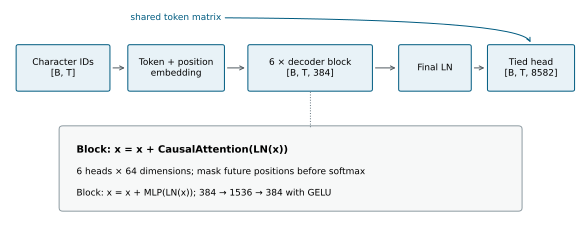
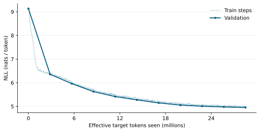
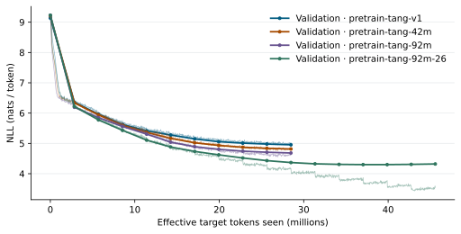
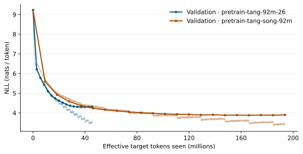
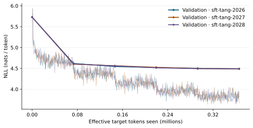
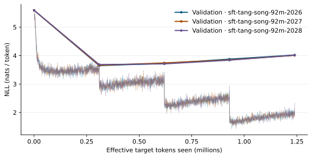
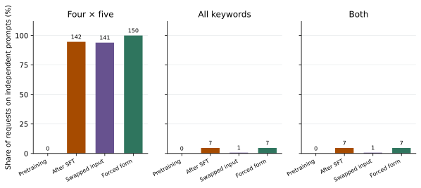
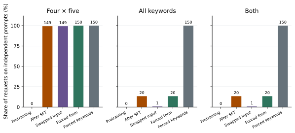

# Orchid：从零训练一个会按题写古诗的 GPT

**课程项目报告 · 实测 · 2026-11-18**

训练设备：单张 NVIDIA GeForce RTX 4080 SUPER（约 16 GiB），Ubuntu 22.04，Python 3.11.16，PyTorch 2.14.1+cu126。本文涉及的训练、生成和评分规则均可在仓库复现；人评分是否已收齐另行说明。

## 一、任务与研究问题

给定 1～3 个关键词，每词 1～2 个汉字，要求模型创作四句、每句五字的诗。例如输入「霜、孤舟」，合格输出既应符合字数，也应在某一句内完整用到每个词。写作质量还涉及切题、通顺、连贯和意境。四句五字只定义了外形，偶句押韵单列检查；模型没有承诺严格的五言律绝。

实验的主问题是：同一套从随机初始化训练的字符 GPT，在自监督预训练后，加入「关键词 → 诗」的监督是否改善条件创作？先用 14M 搭完整对照，再做 42M/92M 的同训练量对比，把长训练和唐宋扩容当成独立实验。模型的交付版本在验证集上选定；主测试结果不参与选择。课程五类证据分别对应本报告的模型知识、模型实现、预训练、微调、分析与体会。

## 二、模型知识与实现（35% + 20%）

**目标函数。** 使用教师强制，序列 `x₀ … xₜ` 的第 `i` 个输入预测实际的 `xᵢ₊₁`，模型直接给原始 logits。对所有未屏蔽目标，损失为正确 token 概率的负对数之和，再除以有效目标 token 数；PPL 是平均 NLL 的自然指数。对于最后一个不满窗口和 SFT 提示，label 用 `-100`；不能用平均批损失的简单均值，否则有更多 padding 的批会被过度加权。[手算交叉熵与梯度累积测试](../tests/test_training.py)覆盖这两类情况。

**字符与位置。** [Tokenizer](../orchid/tokenizer.py) 对 NFC 正文逐汉字或标点编码；训练集字表实际有 8,582 个 token，其中包括 `<pad>`、`<unk>`、`<bos>`、`<eos>` 和四个条件控制标记。每个 token 查入词向量，当前位置再查绝对位置向量，两者相加。小语料下字符级可直接验证五字句，代价是生僻字在测试里可能变成 UNK。整个模型最多处理 256 个 token。

**注意力与因果。** [模型](../orchid/model.py) 从每个位置的向量线性得到 Q、K、V。每个头中，查询对键的分数为 `qᵢ·kⱼ/√dₕ`，其中 `dₕ=64` 是头宽；只给 `j≤i` 的分数做 softmax，再权重累加各 `vⱼ`，于是当前预测无法读取未来标签。并行注意力头给不同关系独立视角。测试故意替换后缀，前缀 logits 逐元素不变，并对比手写公式与 PyTorch SDPA。SDPA 的布尔 `True` 表示允许某个键；数据右填充，真实位置不会通过因果掩码读到后面的 PAD。

**块结构与参数。** 每块先归一化，再做因果注意力并加回残差；随后另做一次归一化，用 GELU 前馈（宽度扩大四倍）再加回残差。归一化控制数值尺度；残差保留输入的信息与梯度路径。最后归一化，再用输入词嵌入的转置投影到词表，一份权重同时服务输入、输出。基线 6 层，宽度 384、6 个头，共 14,041,344 个参数。42M 是 12 层、宽度 512、8 头；92M 是 12 层、宽度 768、12 头。三个版本扩展的是同一代码，没有载入外部模型。

**优化与可复现性。** 训练用 AdamW（β₁=0.9、β₂=0.95，ε=1e-8），只对二维及以上权重做衰减，梯度总范数裁剪为 1，学习率短预热后余弦下降。本机 BF16 autocast 保持 FP32 主参数。训练保存完整模型、优化器、调度器、随机数状态、数据游标、代码与数据哈希。CPU FP32 中途续训测试与连续训练结果逐位一致；实际 GPU 训练也完成了中断恢复。随机初始化后对 24 首训练诗调试 100 步，NLL 从 9.1333 降到 0.1348，给前五字可复现 24/24。这个特意过拟合的小实验只验证机制。

**采样。** 编码给定条件，只读最后位置 logits；用温度缩放，在 top-k/top-p 保留集合里采样，把选中的 token 追加，直到 EOS 或预算。默认温度 0.8、top-k 50、最多 64 个新 token；温度 0 是贪心。推理保持原样，格式约束是显式独立模式。

## 三、预训练的数据、程序和实测（20%）

主语料是固定提交的 chinese-poetry 《全唐诗》。58 个唐诗分片共有 57,607 条，初筛与正文去重后留 51,138 首。按标点而非 `paragraphs` 项数划句；NFC 保留原字形，缺字、夹注和无正文剔除，规范标点且留原文可核对。用正文哈希、四句近重复及嵌入分组，再以种子 2026 在组层面划分。train/validation/test 正文为 46,031/2,557/2,550 首。每首用 BOS/EOS 包裹，各集合各自拼接，取 257 token 片段构成 256 个输入与右移目标。每轮唐诗训练有 2,848,767 个有效目标。

14M 以种子 2026 从随机初始化训练 870 步、10 轮、28,487,670 个目标，验证 NLL 从 9.1361 降到 4.9540（PPL 141.7）。优化耗时 58.9 秒，另计验证、采样和写盘。同一字表与数据下，42M、92M 在 10 轮的验证 NLL 是 4.8151、4.6831。92M 的长配置最多 26 轮，实跑 16 轮，最后三次验证无改善；第 13 轮的 4.2995 为最佳。扩大规模和训练量都降低了留出 NLL，但重复唐诗后来已不能继续改善验证。完整日志与前缀样例见[基线记录](pretraining.md)、[放大实验](scaling.md)。

扩容版额外使用同源 255 个宋诗分片，排除与唐诗相同的正文，以及与唐诗留出集查到的近重复、连续句和内嵌关系。共有 250,790 首新增宋诗，只分到训练集。唐宋训练为 296,821 首，训练流每遍约 1,845 万 token；保留原唐诗字表，唐诗留出正文、流和标签三个版本逐字节不变。具体哈希、过滤器边界和未登录字比例见[数据约定](../docs/data_contract.md)。

92M 唐宋版规划 16 轮、每半轮验证，实际在 10.5 轮连续三次无改善后停止。第 9 轮/5,076 步取得最低 NLL 3.8805（PPL 48.45；累计 166,066,074 个有效目标）。最后一轮已经处理 193,758,254 个有效目标，优化约 30.7 分钟。命令会话中断后从第 1,974 步恢复；核对后的日志从第 1 步到第 5,922 步连续。与唐诗长训相比，训练数据量和调度均不同，差异不应全部归因于宋诗。

## 四、关键词监督微调（20%）

原数据没有已编好的关键词标签。用训练集逐句匹配意象词白名单，保留至少在两首训练诗命中的词，排除停词和长词内的短词。每首选 1～3 个并用固定种子打乱次序，作者和标题不进入提示。原训练 2,929 对，唐宋训练 12,394 对，所有参考标签都能在对应句内按字匹配。弱标签会误把同字地名、典故的一部分当意象，实测记录中有「博山鑪」被选为「山」，这是标签的局限。

监督序列包含 BOS、诗体、关键词、SEP、正文与 EOS。因为标签相对输入右移，SEP 所在位置就预测第一字；屏蔽提示和 padding、保留正文及 EOS 的梯度。每次从本项目自己的最佳预训练权重开始，用新 AdamW。基线试跑把学习率从 3e-5 提到 3e-4，30 次固定验证生成的联合达标由 3 次到 13 次，虽然正文验证 NLL 略升。用三个微调训练种子，完整验证 NLL 分别为 4.4893、4.4885、4.4906；同一掩码、微调之前为 5.7284。各阶段采样原始记录和掩码实例见[微调记录](finetuning.md)、[字段图解](../artifacts/sft_mask_example.json)。

唐宋 92M 加长 SFT 配置上限为 25 轮，峰值学习率 1.5e-4。三个种子均从扩容最佳权重开始，每个实跑 4 轮、1,552 步、123.94 万有效目标；第 1 轮验证 NLL 最好（3.6487、3.6600、3.6871）。90 道验证题的联合成功且未与训练整首/长诗片段匹配为 66、79、95/270，交付版本锁定第三个种子。较低的 NLL 并不总能预测较高的条件命中。

## 五、固定测试、诊断与局限（5% 的证据之一）

主测试用 Codex 独立编写的 50 道无参考诗题，各采样 3 次。辅助测试取 100 首冻存诗作的题，检查完全同口径的正文+EOS NLL；6 个边界输入单列。自动指标分开报告四句五字、所有词有没有完整用在句内、两项同时满足、偶句同韵及与训练诗的匹配。韵表按平水韵；多音或查不到则记待判。比较 R1 预训练、R2 微调、换词后按原条件判分，以及单开的格式约束。只有 R1 与 R2 的原始输出用于主结论。

14M 演示种子 R2-2027 在新题 150 次中有 142 次符合字数、7 次联合达标；R1 均为 0。换成另一组词后，仍按原词只命中 1 次；强制字数可达到 150 次，但用词成功仍只有 7 次。相同条件下，R2-2027 在留出原诗派生的题上有 91/300 次联合成功。两种题目的差距说明续写相似诗句比真正在新条件下写好更容易。

原始输出中的用词堆叠是典型失败。「夜靜秋夜冷，夜涼夜夜霜。夜涼無夜雨，空夜夜秋聞。」写到「霜」且符合字数，偶句不押韵，句意弱并反复叠字。「孤舟、春雨、煙波」有一例首句 7 字且漏三词。训练集匹配检查包括整首、长诗片段和近重复。三次采样共享同一道诗题，统计重采样以题为单位。

14M 的 30 道封存题已获得一位真人和一位独立上下文 AI 子 agent 的匿名评分，各校验 60 条输出和 240 项分值。R2 对 R1 的切题平均差为真人 +2.43、AI +0.70，连贯为真人 +2.67、AI 0.00。240 对同项判断中，111 对相差至少 2 分。两种评阅分别报告，其中双真人结论待第二份同版本真人回件。[四维评分和分布](evaluation_baseline.md#一位真人与一位-ai-的盲评结果) · [评分锚点](blind_review/README.md)

在统一 CUDA 复测中，14M 基线 11/150，42M 15/150，唐诗 92M 十轮 24/150。交付的唐宋 92M 从微调前 0/150 到 20/150（字数 149/150），参考正文 NLL 5.6486 到 3.7227。3 个 SFT 种子联合成功 16、19、20/150；20 次均来自单词题，两个和三个词各 0/51。偶句同韵在 149 条格式合格中有 61 合、40 不合、48 待判，严格常格 0 合、140 不合、9 待判。检测没有发现整首、长诗片段或近重复的训练复现，但检测规则有限。

只强制句长得到 20/150；强制把词放进不同诗句得到 150/150，这只是接词与字数的保证。把题换掉再按原题评分只达 1/150。增加训练量和诗料改善了同口径参考损失，但这批新题上，验证集选出的版本没有超过十轮唐诗版的按词达标率，后续优先改善多词标签与条件学习。详见[扩容评估](evaluation_expanded.md)、[格律文献复核](prosody_source_audit.md)、[盲评材料](blind_review/README.md)。

为回应评阅反馈，另在 92M 原权重上进行两组匹配续训。每组使用相同关键词配比的 4,096 条训练样本，在本机 RTX 4080 SUPER 上训练 6 轮、384 步。一组普通随机抽样，另一组限于偶句用不同字押同一平声韵的样本。90 道固定验证题各采 3 次，自由生成可靠押韵数从原权重的 117/270、普通续训的 119/270，提高到同韵组的 188/270。格式与所有词同时达标数分别为 87、103、109/270，按预先约定选择韵律续训权重。

在原 50 道新题上，用同一新权重测量解码贡献。押韵按第二、第四句末字不同、同属平水韵一个平声部计。默认解码在生成时规范字数和韵脚，并按原模型对数概率与重复惩罚，从不同关键词落点的候选中选择一首。

| 新权重的生成方式 | 五言四句 | 偶句异字同韵 | 字数、押韵及全词同时达标 |
|---|---:|---:|---:|
| 自由生成 | 148/150 | 92/150 | 17/150 |
| 仅限字数 | 150/150 | 93/150 | 17/150 |
| 字数和押韵 | 150/150 | 150/150 | 25/150 |
| 默认，另限关键词并排序 | 150/150 | 150/150 | 150/150 |

自由生成仍难用全两词或三词，默认解码提高了可控性。进一步逐字复核默认模式的 150 首，按四套五言常格及对应押韵，有 1 首合、146 首不合、3 首待判。常格诊断保留多音和缺字引起的不确定性，通顺度、意境及平仄变格仍需读者评价。已有盲评针对原始权重和输出。[续训、推理消融及逐条记录](prosody_optimization.md) · [平仄常格指标](evidence/meter-prosody.json)

## 六、实验体会与贡献记录（5%）

本次实测最有价值的三项发现是：先按正文分组划分，比切 token 后去重更能保护验证；训练损失下降可能只代表更会延续旧诗，从验证和独立新题上才能区分「会续」「会按题写」；GPU 吞吐不是显存占用的单调函数，92M 微批 64 使用更多显存却不比微批 32 快。工程中修复了右移尾部索引边界、ROS 环境串入 Python 路径和长作业会话中断；可运行测试和日志说明对应修复。追加宋诗的理由是预训练已经出现过拟合信号，给模型新的诗句比让它反复见到同一批诗更有机会提升泛化。

实际分工：项目发起者确定写古诗的课程方向、核验 CUDA 环境并提出扩大本机训练资源与轮次；Codex 协助实现、执行测量并整理记录。个人学习体会与课程署名由提交者本人核对补充，本报告不代填他人的个人经历。

## 七、复现和来源

从 [README](../README.md) 的命令复跑环境、数据、字表、从零预训练、续训、监督构建、三个 SFT 种子、评估与推理。各次执行的真实配置、逐步日志、样例和结果哈希保存在 [evidence](evidence/)；图表原数据与矢量文件保存在 [figures](figures/)。模型权重在本机 checkpoint 或 `dist/`，不上 Git；按 README 打包上传到课程允许的私有存储后可填写课程下载入口。

- [Sebastian Raschka，LLMs-from-scratch](https://github.com/rasbt/LLMs-from-scratch/tree/0311973e2c974b9e0223933103dc400c7a536179)：第 2–5、7 章的教学参考。项目自己实现训练、字表、掩码和推理。
- [Andrej Karpathy，nanoGPT](https://github.com/karpathy/nanoGPT/tree/3adf61e154c3fe3fca428ad6bc3818b27a3b8291)：字符级训练、日志和采样组织参考。
- [chinese-poetry，唐诗与宋诗分片](https://github.com/chinese-poetry/chinese-poetry/tree/b8594f81a89752241442f2ce267d6f66f96704ee/%E5%85%A8%E5%94%90%E8%AF%97)：固定快照，访问日期 2026-11-18；许可、使用范围、校验和见[第三方登记](../THIRD_PARTY_NOTICES.md)。
- [Guo 等，Jiuge](https://aclanthology.org/P19-3005/)、[Zhang 与 Lapata，Chinese Poetry Generation](https://aclanthology.org/D14-1074/)、[Yu 等，CharPoet](https://aclanthology.org/2024.acl-demos.30/)：关键词写作和格式与人工评价参考，未借用权重。
- 韵表用于韵脚诊断、训练子集筛选和推理解码。[王力《诗律》](https://www.aisixiang.com/data/98039.html) · [固定版本平水韵 JSON](https://github.com/rbnyng/pingshui_rhyme/blob/0d6b05a932ff1828d8403e7a0de67dd1f6bd81d0/pingshui_rhyme/data/organized_ping_ze_rhyme_dict.json)
